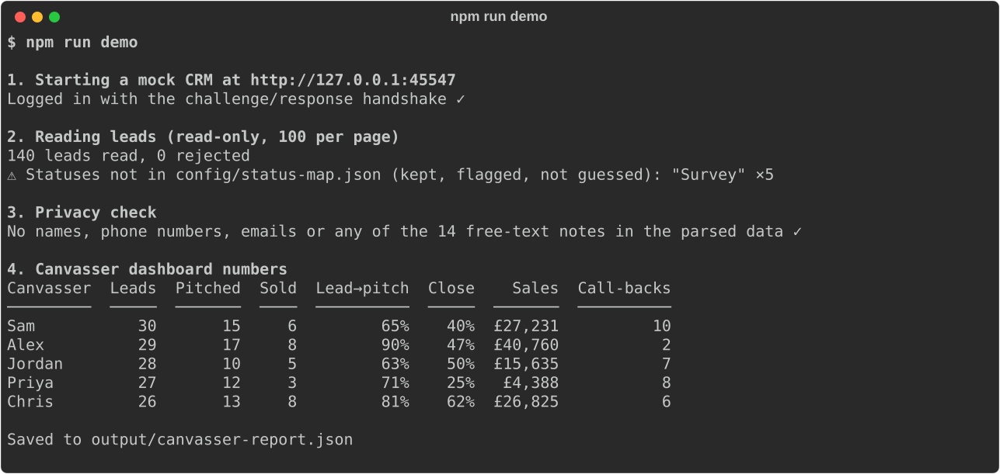
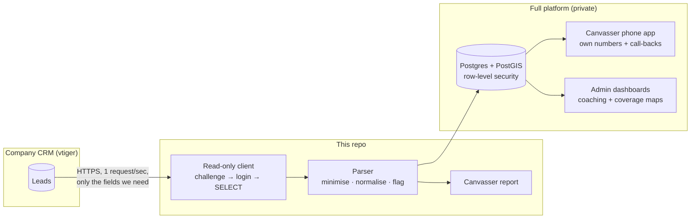

# Canvasser Performance Platform: CRM integration kit

**Give every door-to-door canvasser their own live performance numbers, straight from the company CRM, without copying customers' personal data anywhere.**

This repository is the runnable integration core of a field-sales platform I built for a home-improvement canvassing team. It shows how the platform reads a legacy CRM safely and turns raw lead records into each canvasser's dashboard. It comes with a mock CRM, so you can run the whole thing in two commands, with no accounts or keys.



---

## The problem

Canvassers knock doors and book appointments. The office records what happened next (sold, pitched but missed, cancelled, couldn't contact) in a legacy CRM built for office staff, not for people on the doorstep. Canvassers had no quick way to see their own conversion rates, or which of their leads were worth ringing back.

**For whom:** canvassers (their own numbers and call-back list, on their phone), team leaders (coaching from real data), and the office (no extra admin).

**Constraints I had to design around:**

- The CRM belongs to the employer. **Management approved API access, and I designed the app so that it can only read, never change anything.**
- Lead records contain customers' names, phone numbers and notes. **The app should hold as little of that as possible.**
- The CRM is a shared, older server. **Requests must be gentle.**

## What's in this repo

| Part | What it does | File |
|---|---|---|
| **Read-only CRM client** | Logs in with vtiger's challenge/response handshake and runs `SELECT` queries. Any write operation is blocked in code, before a request is sent | [`src/crm/client.ts`](src/crm/client.ts) |
| **Field map** | Maps "what the app needs" to *your* CRM's field names (`cf_123` → `saleAmount`) in a JSON file, not in code | [`config/crm-fields.json`](config/crm-fields.json) |
| **Lead parser** | Normalises postcodes and dates (including BST/GMT), finds sale prices typed into free-text notes, and labels call-back reasons. Names, phones and notes never leave it | [`src/crm/parse.ts`](src/crm/parse.ts) |
| **Sync** | Counts, then pages through leads 100 at a time, optionally only those changed since a date. Unknown statuses are flagged, never guessed | [`src/crm/sync.ts`](src/crm/sync.ts) |
| **Canvasser report** | Leads, pitches, sales, lead-to-pitch rate, close rate, sales value and call-backs per canvasser | [`src/report/canvasser.ts`](src/report/canvasser.ts) |
| **Mock CRM** | A small vtiger-compatible server with 140 fictional leads, for the demo and tests | [`mock/crm-server.ts`](mock/crm-server.ts) |

## How it fits together



The parts in **This repo** are taken from the production code and cleaned of anything company-specific. The **full platform** stays private because it runs on the employer's data. See [About the full platform](#about-the-full-platform) below.

---

## Quick start

You need **Node.js 20.12 or newer**. Check with `node --version`, and if it's missing or older, install the LTS version from [nodejs.org](https://nodejs.org).

### 1. Download and install

```bash
git clone https://github.com/nomaan02/canvasser-performance-platform.git
cd canvasser-performance-platform
npm install
```

**You should see:** `added … packages` and no errors.

### 2. Run the demo

```bash
npm run demo
```

**You should see:** the four steps in the screenshot above: the mock CRM starting, 140 leads read across two pages, the privacy check passing, and a table of five canvassers. The numbers are also saved to `output/canvasser-report.json`.

### 3. Run the tests (optional)

```bash
npm test
```

**You should see:** `# pass 15` and `# fail 0`. The tests prove the client can't write to the CRM, that paging gets every lead, and that the parser handles real-world mess (HTML entities, prices typed as `£4,250` or `4250`, times that look like prices, the clocks changing).

---

## Using it with a real CRM

> Only do this with a CRM you're authorised to read, using a user whose access your organisation has approved.

1. **Find your access key.** In vtiger, click your avatar → **My Preferences** → scroll to **Access Key**. It isn't your password.
2. **Create your settings file:**
   ```bash
   cp .env.example .env
   ```
   Open `.env` and fill in `CRM_BASE_URL`, `CRM_USER` and `CRM_ACCESS_KEY`. Never commit this file. It's already in `.gitignore`.
3. **Map your fields.** Your CRM's custom fields will have different numbers. Find them under **Settings → Module Layouts → Leads**, then edit [`config/crm-fields.json`](config/crm-fields.json) and [`config/status-map.json`](config/status-map.json).
4. **Run it:**
   ```bash
   npm run sync
   ```
   **You should see:** how many leads were read, then the same table as the demo.

**Want to try `npm run sync` without a real CRM?** Run `npm run mock-crm` in one terminal, and use the mock settings shown at the bottom of `.env.example` in another.

### If something goes wrong

| Message | What it means | Fix |
|---|---|---|
| `CRM_BASE_URL must be set` | No `.env`, or it's empty | Do step 2 |
| `CRM refused: Invalid username or access key` | Wrong user, or you used the password | Copy the **Access Key** from My Preferences |
| `CRM HTTP 404` | Wrong address | Use the CRM's root URL, without `/webservice.php` |
| `Blocked CRM operation …` | Something tried to write to the CRM | Working as designed. This kit only reads |
| `⚠ Statuses not in config/status-map.json` | Your CRM uses a status the app doesn't know | Add it to `config/status-map.json`. Until then those leads are kept but not counted as any outcome |

---

## Design decisions

- **Read-only by construction, not by promise.** The client has an allow-list of read operations and a check that every query is a single `SELECT … FROM Leads`. A test also fails if a write operation ever appears in the client's source. "We agreed not to write" became "the code cannot write".
- **Data minimisation at the source.** Names, emails and phone numbers aren't in the field list, so they are never requested. Free-text notes *are* read, because staff often type the sale price there, but only the extracted number or a call-back label leaves the parser. The demo checks this on every run.
- **Flag, don't guess.** A CRM status the app doesn't recognise is kept raw and reported, rather than silently counted as something else.
- **Be gentle with someone else's server.** At most one request per second, paging in the CRM's maximum of 100, and an automatic single re-login if the session expires.
- **Configuration over code.** Every vtiger install names its custom fields differently, so the mapping lives in JSON. Pointing the kit at a different CRM means editing a file, not the code.

## About the full platform

The private production app (Next.js 15, TypeScript, Supabase/Postgres with PostGIS, MapLibre GL) adds:

- **A personal login and dashboard for every canvasser,** on their phone. It shows their own leads, results, "this week" view and call-back list. Row-level security means each canvasser can only ever see their own CRM data.
- **Offline-first field logging,** with an on-device queue that syncs idempotently when signal returns. Raw GPS never leaves the phone.
- **One identity per door:** the UPRN (Unique Property Reference Number) from Ordnance Survey's open data, labelled with addresses from the government's open EPC register. CRM leads are matched to a door by postcode, house number and street.
- **Admin tools** for coverage maps, deterministic door-to-door routes, team insights and coaching.

## How I used AI to build this

The platform was built in 140 commits between September and October 2026, using **Cursor** and **Claude** as coding agents. I worked as the product owner and reviewer:

- **I wrote the spec first.** A build brief set out the product, the data model and the rules, and an `AGENTS.md` file listed hard rules every agent session had to follow. For example: *the CRM is read-only*, *no customer names in the field app*, *every table has row-level security*.
- **Work was split into small numbered stages,** each with its own verify script (`npm run verify:crm` and so on) that the agent had to pass before handing back.
- **Every session ended with a written handoff:** what changed, which checks passed, and what still needed testing on a real phone. I reviewed every change and made every commit myself.

The safety rules in this kit, like the write-blocking and the data minimisation, were written into that spec before any code existed. The AI implemented them, and the tests hold them in place.

## Licence

[MIT](LICENSE). The CRM data the full platform reads is not included and remains the property of its owner.
